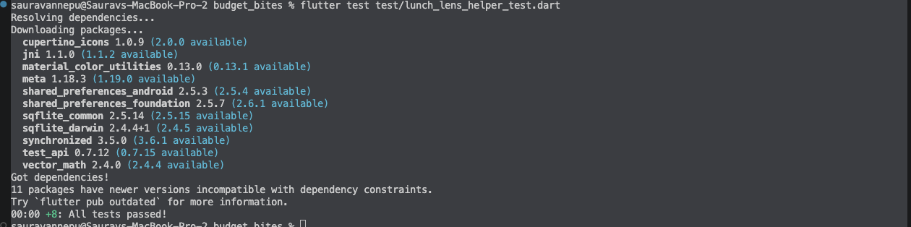

# AI Feature: Lunch Lens

## What it does
So Lunch Lens basically guesses what your next purchase at a meal spot will probably cost. It shows a card with the guess and you can hit Apply to fill in the cost box or Not now to just hide it. So it kind of saves you typing and you know like what to expect before you even buy.

## Inputs
- the past purchase costs for that one meal in cents from the purchase_logs table
- thats basically it, no personal info and no internet

## This How it works
Its rule based so its not like a trained model. It skips any cost thats 0 or less and then it takes the 3 newest costs at that meal and averages them and rounds to the nearest cent. If theres less than 3 good costs it just says "Not enough data yet".

The logic is in lib/helpers/lunch_lens_helper.dart as plain dart functions so its kind of separate from the ui and we could unit test it.

## Why we picked this one
An average of a few recent purchases is simple and easy to explain and it works offline. Only using the last 3 means it basically keeps up if prices change and needing 3 means like one purchase doesnt count as a pattern.

## What else we thought about
Using the median of the last 3 instead. It handles one weird big order kind of better (look at the counterexample below).

## Baseline
Its just the last price you paid at that meal.

## User control
- the card says "Smart helper (suggested, not guaranteed)" and shows why, like "Based on your last 3 logs here: $8.50, $9.25, $9.10"
- Apply only fills in the cost box so nothing saves until you hit Log meal
- Not now basically just hides the card
- it all works offline

## Test cases
So the unit tests are in test/lunch_lens_helper_test.dart and you can run them with `flutter test test/lunch_lens_helper_test.dart`. All 8 of them pass.

| Case | Input (cents, newest first) | What should happen | Result |
|---|---|---|---|
| Normal | 910, 925, 850 | guess $8.95 and baseline $9.10 | Pass |
| No data | no purchases | says "Not enough data yet" | Pass |
| Boundary | 900, 800 (only 2) | not enough data | Pass |
| Invalid | 900, 0, -500, 850, 800 | skips the 0 and -500 and guesses $8.50 | Pass |
| Invalid | 900, 0, 800 | only 2 good costs left so not enough data | Pass |
| Outlier | 2700, 900, 900 | guesses $15.00 which is way too high | Pass |
| Counterexample | 1200, 800, 800 | guesses $9.33 but the baseline $12 is right | Pass |
| Only 3 newest | 1000, 1000, 1000, 5000 | guesses $10.00 and ignores the old $50 | Pass |

The log purchase form also kind of stops bad input before it even saves so if you type like 0 or -5 it shows "Please enter a valid positive cost."

## How we tested it
We used average error in dollars which is basically just how far off the guess was from what the next purchase actually cost.

We used 5 small made up purchase histories so its more of a demo and not like proof that it works for everyone.

| History (oldest to newest) | Actual next | Lunch Lens | Error | Baseline | Error |
|---|---|---|---|---|---|
| $8.50, $9.25, $9.10 | $9.00 | $8.95 | $0.05 | $9.10 | $0.10 |
| $12.00, $11.50, $13.00 | $12.25 | $12.17 | $0.08 | $13.00 | $0.75 |
| $6.00, $6.50, $5.75 | $6.25 | $6.08 | $0.17 | $5.75 | $0.50 |
| $9.00, $9.00, $27.00 | $9.50 | $15.00 | $5.50 | $27.00 | $17.50 |
| $7.50, $8.00, $7.75 | $8.00 | $7.75 | $0.25 | $7.75 | $0.25 |
| **Average error** | | | **$1.21** | | **$3.82** |

So basically Lunch Lens was closer than the baseline on average.

## Counterexample
If the menu price goes up like $8, $8 and then $12, Lunch Lens guesses $9.33 but the real price is $12 now. The baseline actually gets it right here since it only looks at the last price. Also one big group order like $9, $9 and then $27 pushes the guess up to $15 which is kind of way too high for a normal meal.

## What we changed and whats still a problem
In our proposal it was gonna guess after just 1 purchase but we changed it to need 3 so like one purchase doesnt really count as a pattern. We also made it skip costs of 0 or less so one bad log cant mess it up.

We kept the average because it beat the baseline overall and its easy to explain. The problem is its kind of slow to catch price changes and one big order basically throws it off for the next few purchases. Later we could use the median or let you mark a purchase as a group order so Lunch Lens just skips it.